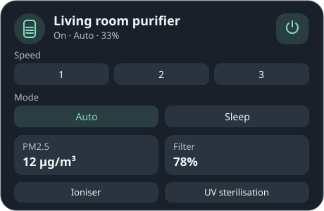
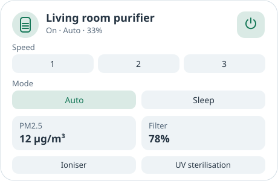

# AirDeck Air Purifier Card

[](https://hacs.dev/docs/faq/custom_repositories/)
[](https://github.com/szbence7/airdeck-air-purifier-card/releases)
<a href="https://www.buymeacoffee.com/benceix"></a>

AirDeck is a Home Assistant air purifier dashboard card for devices exposed as a `fan` entity. Choose your purifier in the visual editor. AirDeck adapts to the speed controls and operating modes the device reports. You can add separate PM2.5 and filter sensors, plus UV and ioniser controls.

| Dark mode | Light mode |
| --- | --- |
|  |  |

## Install

1. Open **Marketplace → Add from link** in Home Assistant. On HACS, use **Custom repositories**.
2. Add `https://github.com/szbence7/airdeck-air-purifier-card` as **Dashboard**.
3. Install **AirDeck Air Purifier Card**, then reload your browser.
4. Edit your dashboard and select **Add card → AirDeck Air Purifier Card**. Choose your purifier, then use the switches and entity pickers to customise the card.

## Configure

Choose a `fan` entity first. The card shows a power button where supported, speed buttons for up to five speeds and a slider for more speeds. Operating modes come from the entity, so Auto and Sleep appear when your purifier provides them. Features absent from the integration are omitted.

Each section can be hidden independently. The sensors, UV and ioniser are optional. A switch shows its current state and toggles when pressed. A script runs once per press, so choose a toggle script if you want one button to handle both directions.

```yaml
type: custom:airdeck-air-purifier-card
entity: fan.living_room_purifier
show_power: true
show_speed: true
show_presets: true
show_air_quality: true
pm25_entity: sensor.living_room_pm25
show_filter: true
filter_entity: sensor.purifier_filter_life
show_ioniser: true
ioniser_entity: switch.purifier_ioniser
show_uv: true
uv_entity: switch.purifier_uv
```

Once the card sees the purifier turn on, it can show the PM2.5 change for that run. This compares the readings it sees while the dashboard is open. It starts a new comparison on the next run and does not estimate readings from before the page loaded.

## What’s new

See the [changelog](CHANGELOG.md) and [GitHub releases](https://github.com/szbence7/airdeck-air-purifier-card/releases).
